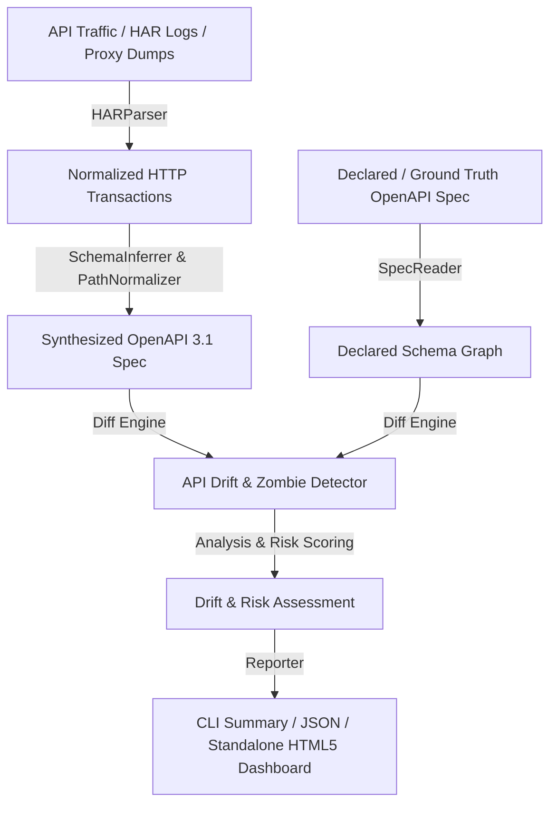

# ShadowAPI Architecture

## Executive Summary
ShadowAPI is an Autonomous API Drift & Zombie Endpoint Discovery Engine. It monitors observed API traffic (HAR archives, proxy dumps, raw logs) and compares inferred endpoint schemas against declared ground-truth OpenAPI specifications to uncover shadow (undocumented), zombie (deprecated yet active), and drifted APIs.

## Architecture Diagram

## Core Components
1. **Traffic Parser (`shadowapi/core/har_parser.py`)**:
   - Parses HTTP Archive (HAR) format.
   - Extracts request methods, URLs, path tokens, headers, query parameters, request bodies, response status codes, and response payloads.
2. **Path Parameter Normalizer & Schema Inferrer (`shadowapi/core/schema_inferrer.py`)**:
   - Normalizes variable path segments (e.g., `/api/v1/users/9482/orders` -> `/api/v1/users/{user_id}/orders`, UUIDs, alphanumeric hashes, integers).
   - Infers strict JSON schemas for request and response payloads, tracking nullable fields, types, and required attributes.
   - Flags sensitive leaked data (PII, tokens, internal keys) in response schemas.
3. **OpenAPI 3.1 Spec Builder (`shadowapi/core/spec_builder.py`)**:
   - Compiles normalized routes and inferred schemas into a valid OpenAPI 3.1 specification.
4. **Drift & Zombie Detector (`shadowapi/engine/drift_detector.py`)**:
   - Compares ground-truth OpenAPI specs against observed runtime specs.
   - Detects:
     - **SHADOW**: Endpoints observed in traffic but missing from ground truth.
     - **ZOMBIE**: Endpoints marked deprecated or deleted in spec but still receiving traffic.
     - **SCHEMA_DRIFT**: Undocumented request fields, type changes, or missing documented query parameters.
     - **AUTH_GAP**: Documented auth requirement bypassed or missing in observed traffic.
5. **Risk Scorer & Reporter (`shadowapi/engine/reporter.py`)**:
   - Computes API Risk Score (0-100) aligned with OWASP API Security Top 10.
   - Generates interactive self-contained HTML dashboards and machine-readable JSON.
