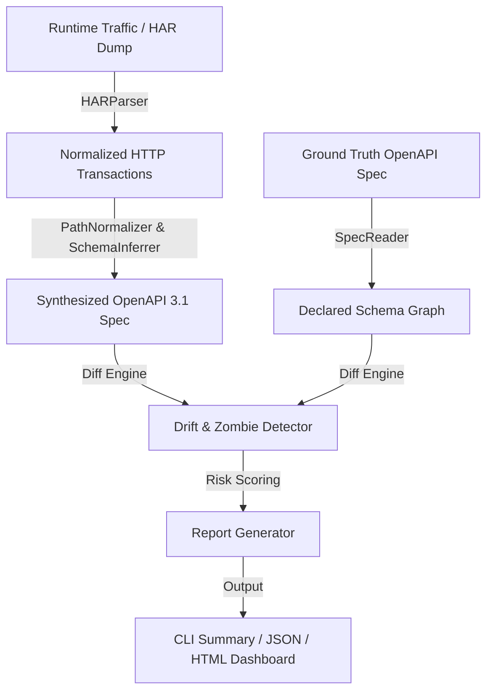

# ShadowAPI 🔍

> **Status:** prototype. A personal security-research project, not a production product. Expect rough edges; issues and pull requests are welcome.

> **Autonomous API Drift & Zombie Endpoint Discovery Engine**

ShadowAPI is a prototype automated API surface analysis and drift detection platform. It continuously evaluates observed HTTP traffic (HAR archives, proxy dumps, gateway logs) and contrasts inferred runtime schemas against declared ground-truth OpenAPI specifications to pinpoint shadow (undocumented), zombie (deprecated yet active), and drifted APIs.

---

## 🌟 Key Capabilities

- **Zero-Config Traffic Ingestion**: Parses standard HTTP Archive (HAR 1.2) dumps and raw HTTP transaction logs.
- **Dynamic Path Parameter Normalization**: Automatically abstracts dynamic resource identifiers (`/users/42/orders/99` $\to$ `/users/{user_id}/orders/{order_id}`, UUIDs, hex commit hashes).
- **Automated OpenAPI 3.1 Synthesis**: Reconstructs complete, structured OpenAPI 3.1 definitions directly from recorded traffic.
- **Differential Drift Engine**: Identifies:
  - 💥 **Shadow Endpoints**: Unregistered endpoints actively receiving requests (OWASP API9:2023).
  - 🚨 **Zombie Endpoints**: Deprecated routes that remain online and operational.
  - 💥 **Authentication Gaps**: Documented protected endpoints accessed without authentication credentials.
  - ⚠️ **Schema Drift**: Undocumented request properties, type mutations, or query parameter drift.
  - 🚨 **Sensitive Data Exposure**: Unmasked leaks of API keys, AWS credentials, JWTs, and PII in response bodies.
- **Interactive Visual Reporting**: Emits CLI risk summaries, JSON reports for DevSecOps pipelines, and standalone HTML5 audit dashboards.
- **CI/CD Quality Gate**: Enforces risk score thresholds (`--fail-on-risk 50`) to block pull requests introducing unmanaged API surface sprawl.

---

## 📐 Architecture



---

## 🚀 Quick Start

### 1. Installation

```bash
git clone https://github.com/csenta/shadowapi.git
cd shadowapi
pip install -r requirements.txt
```

### 2. Synthesize OpenAPI 3.1 Spec from Traffic

```bash
python3 -m shadowapi.cli synthesize \
  --traffic examples/traffic.har \
  --output synthesized_spec.json
```

### 3. Detect Drift and Zombie Endpoints

```bash
python3 -m shadowapi.cli diff \
  --traffic examples/traffic.har \
  --spec examples/declared_spec.json \
  --output-json report.json \
  --output-html report.html
```

### 4. Enforce CI/CD Risk Gate

```bash
python3 -m shadowapi.cli scan \
  --traffic examples/traffic.har \
  --spec examples/declared_spec.json \
  --fail-on-risk 50
```

---

## 🛠️ Testing

Run the test suite:

```bash
PYTHONPATH=. python3 -m unittest discover -s tests -v
```

---

## 🐳 Docker Deployment

Run with Docker Compose:

```bash
docker-compose up --build
```

## License

MIT. See [LICENSE](LICENSE).
